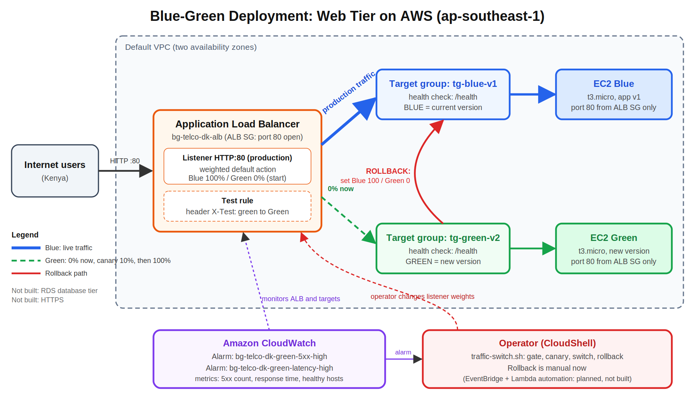
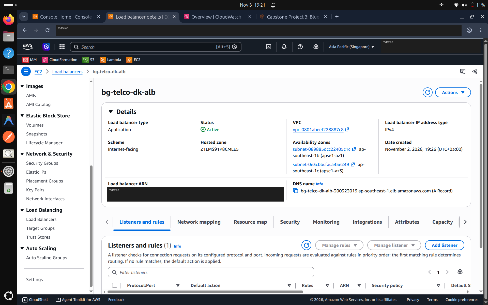
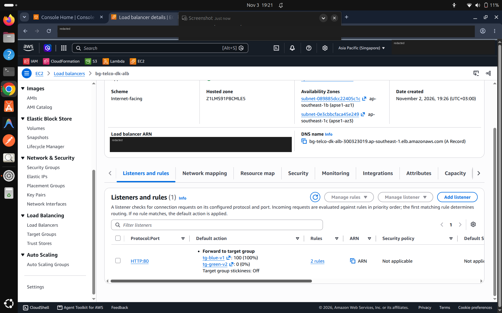
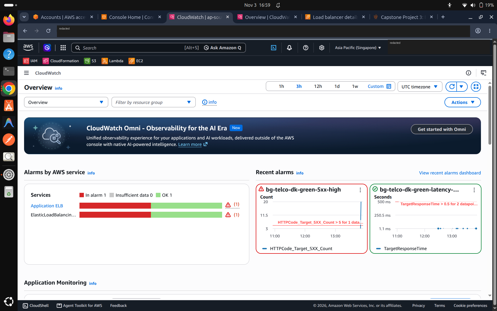
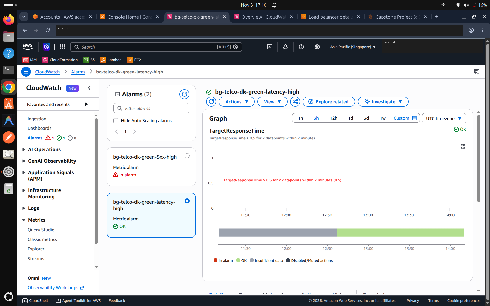
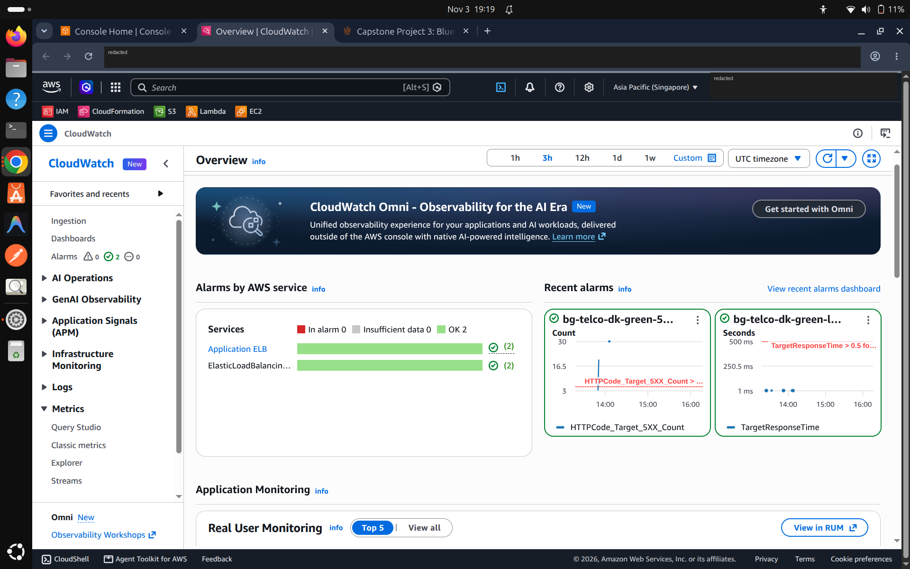

# aws-bluegreen-capstone# AWS Blue-Green Deployment Capstone (Week 3)

Zero-downtime Blue-Green deployment for the web tier of a three-tier application for a Nairobi-based telecommunications provider, built on AWS in **ap-southeast-1 (Singapore)**.

An Application Load Balancer (ALB) sends production traffic to a **Blue** target group (current version) and a **Green** target group (new version). Green is deployed and validated first, traffic is shifted gradually, and the listener can be switched back to Blue if CloudWatch alarms fire.

> **Author:** DAUDI KAZUNGU  |  **Course:** AWS DevOps  |  **Submitted:** 4/11/26

## Architecture


```
Internet users
      |
      v
Application Load Balancer  (bg-telco-dk-alb, HTTP :80)
  weighted default action
      |                         |
      v                         v
 tg-blue-v1                tg-green-v2
      |                         |
      v                         v
 EC2 Blue (v1)             EC2 Green (new version)
```

| Item | Choice | Reason |
|---|---|---|
| Traffic switching | Weighted forwarding on one listener | One setting changes the split, and rollback is the same change in reverse |
| Test path | Listener rule matching the header `X-Test: green` | Validates Green through the real ALB while users stay on Blue |
| Environment parity | Same AMI, instance type, IAM profile and security group for both | Prevents differences between Blue and Green |
| Network access | Instances accept port 80 only from the ALB security group, no SSH | Least privilege |
| Connection draining | 30 s deregistration delay | Lets in-flight requests finish |

## Repository layout

```
README.md
docs/
  rollback-plan.pdf          Rollback plan and verification report
  architecture-diagram.png   Diagram with Blue, Green, ALB and traffic flow
scripts/
  userdata-blue.sh           Starts the Blue app (version v1)
  userdata-green.sh          Starts the Green app
  traffic-switch.sh          Health gate, canary, switch and rollback
evidence/
  *.png                      Screenshots (account details blurred)
  traffic-switch.log         Timestamped output of the traffic script
```

## The demo application

A small dependency-free Python web server started through EC2 user data. It exposes:

- `/` shows the version and colour
- `/health` is the ALB health-check path
- `/api/data` returns sample data

Every response carries `X-App-Version` and `X-App-Color` headers, which prove which environment answered a request.

## Traffic switch script

`scripts/traffic-switch.sh` looks up the ALB, listener and target groups by name, so it contains no IDs or secrets.

| Command | What it does |
|---|---|
| `status` | Shows listener weights, target health and alarm states |
| `gate` | Passes only if every Green target is exactly `healthy` and no matching alarm is in ALARM |
| `canary [PCT]` | Runs the gate, then sends PCT% (default 10) to Green |
| `switch` | Runs the gate, then sends 100% to Green (requires a canary first) |
| `rollback [reason]` | Sends 100% back to Blue. It has no gate, so it always works |
| `sample [N]` | Sends N requests and counts the version and colour that answered |

Safety features: exact-match health gate, alarm gate, read-back of the weights after every change, and a log of every action. Only the listener's default action is changed, so the `X-Test: green` rule is left alone.

Usage in AWS CloudShell:

```bash
chmod +x traffic-switch.sh
export AWS_REGION=ap-southeast-1
./traffic-switch.sh status
DRY_RUN=1 ./traffic-switch.sh canary 10    # shows the plan, changes nothing
```

Defaults (override with environment variables): ALB `bg-telco-dk-alb`, target groups `tg-blue-v1` and `tg-green-v2`, listener port `80`, alarm prefix `bg-telco-dk`.

## Monitoring
## Evidence

### ALB and listener

*bg-telco-dk-alb is active and spans two availability zones.*


*HTTP:80 default action: tg-blue-v1 at 100%, tg-green-v2 at 0%.*

### CloudWatch alarms

*The 5xx alarm fired after Green returned errors from the /fail route.*


*Latency alarm: TargetResponseTime above 0.5 s for 2 datapoints within 2 minutes.*


*Both alarms returned to OK. This was not caused by the rollback, because missing data counts as healthy.*
| Alarm | Condition | Purpose |
|---|---|---|
| `bg-telco-dk-green-5xx-high` | More than 5 5xx responses per minute | Detects application errors on Green |
| `bg-telco-dk-green-latency-high` | Response time above 0.5 s for 2 minutes | Detects slow responses on Green |

## Deployment flow

1. Deploy the new version to Green only. Blue is not touched.
2. Check Green target health in the ALB.
3. Smoke-test Green through the `X-Test: green` header rule.
4. Run `traffic-switch.sh gate`, then `canary 10` and watch the alarms.
5. Run `switch` to move 100% to Green. Keep Blue running as a fallback.
6. If a trigger fires, run `traffic-switch.sh rollback` and verify 20 of 20 responses come from Blue.

Full triggers, commands and verification steps are in `docs/rollback-plan.pdf`.

## Results

**Observed**

- Blue and Green environments, target groups, ALB and weighted listener built and verified in the AWS account.
- Green smoke-tested through the header rule while users stayed on Blue.
- Canary at 90/10, then cutover to 0/100 with 20 of 20 responses from the new version.
- A `/fail` route returned 500 errors and the 5xx alarm reached ALARM.
- Manual rollback returned 20 of 20 responses from Blue.
- On 2026-11-03 (UTC) the script's `status`, `gate`, a dry-run `canary` and `sample` were run, and the listener stayed at Blue 100 / Green 0.

**Planned, not built**

- Automated rollback: CloudWatch alarm, then EventBridge, then Lambda, then listener change, with SNS notification.

## Limitations

- Rollback was started by a person, so there is no measured alarm-to-recovery time.
- The script's live `canary`, `switch` and `rollback` paths were not run. Earlier live switching used manual commands.
- The 5xx alarm returned to OK on its own because missing data counts as healthy, not because the rollback fixed anything.
- Each environment has one instance. There is no database tier.
- The site uses HTTP only. Production would use HTTPS with an ACM certificate and a domain.
- Test traffic came from curl requests, not real user load.
- The nearest AWS region to Kenya is Africa (Cape Town), but this project used ap-southeast-1 as instructed.

## Security notes

- No SSH and no key pairs. Shell access is through SSM Session Manager.
- Instances accept traffic only from the ALB security group.
- IMDSv2 is required, and the app runs as an unprivileged user.
- The instance role has only SSM and CloudWatch agent permissions.
- No credentials are stored in this repository. Screenshots have the account ID and email blurred.

## Cost and cleanup

The ALB, two `t3.micro` instances and public IPv4 addresses cost money while they exist. Delete them after submission.

Check names and IDs first, because the Green instance may have been replaced during testing:

```bash
aws ec2 describe-instances --filters Name=tag:Project,Values=bg-telco-dk Name=instance-state-name,Values=running \
  --query "Reservations[].Instances[].[InstanceId,Tags[?Key=='Name']|[0].Value]" --output table
```

Then delete in this order:

1. The ALB (this removes its listener and rules), then wait about a minute.
2. Target groups `tg-blue-v1` and `tg-green-v2`.
3. The EC2 instances (terminate them).
4. After the instances are gone: security groups `bg-telco-dk-ec2-sg`, then `bg-telco-dk-alb-sg`.
5. CloudWatch alarms and any dashboard, the SNS topic if you made one.
6. IAM: remove the role from the instance profile, delete the instance profile `bg-telco-dk-ec2-profile`, detach the two policies, delete the role `bg-telco-dk-ec2-role`.

Do not delete the default VPC if other people use the account. Finally, check Cost Explorer a day later to confirm charges have stopped.
